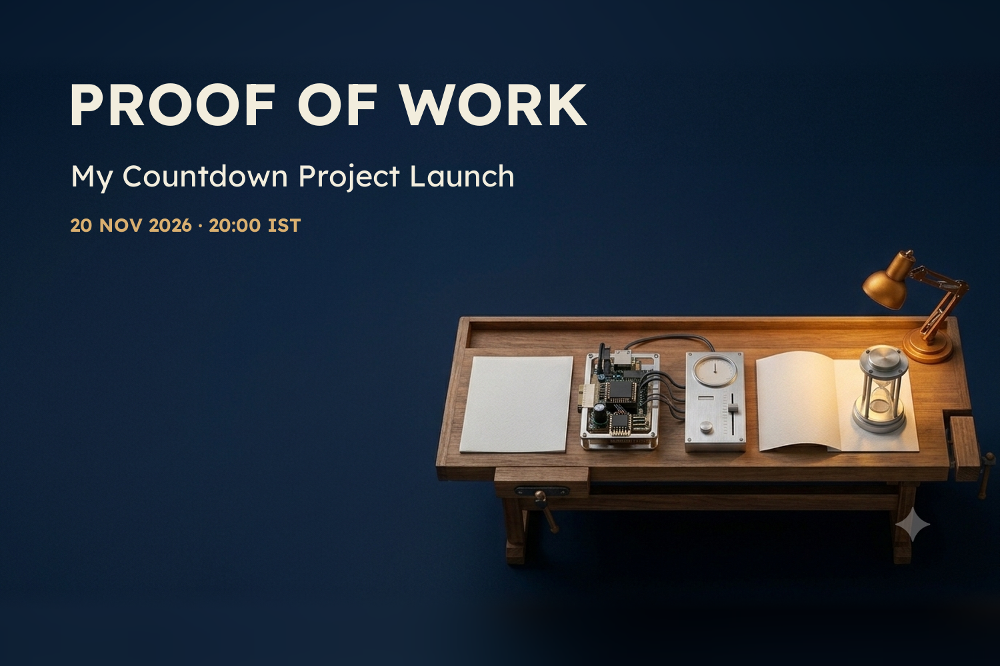
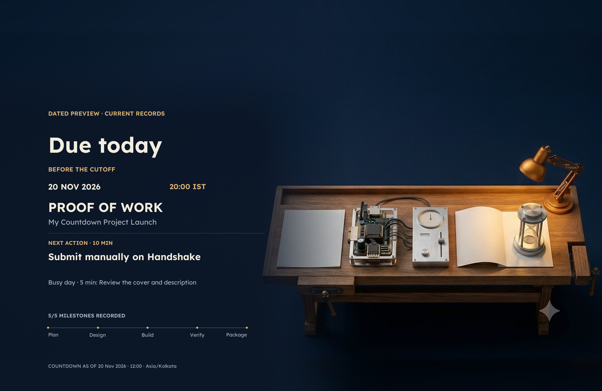

# PROOF OF WORK
## My Countdown Project Launch

**[Open the project website](https://proof-of-work-countdown.siddiqueraiyan2001.chatgpt.site/)** — preview the wallpaper and download the files without signing in.

A calm countdown wallpaper for my MacBook Air: one deadline, one useful next action and five milestones backed by recorded work.



**Personal deadline:** 20 November 2026, 8:00 p.m. IST (`Asia/Kolkata`).  
**Edition:** 18 November 2026 · **2 calendar days remaining** · **5/5 milestones recorded**.

[Open the full-size wallpaper](final-lock-screen.png) · [Read the one-page project summary](project-summary.pdf) · [Download the cover](cover.png)


### What it does

- Shows a correct calendar-day countdown in the named timezone.
- Keeps time remaining separate from completed work.
- Gives one useful next action and a smaller five-minute fallback.
- Carries missed work forward without automatically filling a progress dot.
- Exports a crisp 2560 × 1664 PNG, a reduced preview and a matching 3:2 cover.

This is a **static image**. Refresh it locally and replace the wallpaper manually; it is not a live lock-screen integration or a background app.

### Current project state

| Stage | Recorded state |
| --- | --- |
| Plan | Complete: bounded goal, capacity, milestones and recovery rule |
| Design | Complete: original Gemini workshop and precise composition |
| Build | Complete: working exporter and fresh passing tests |
| Verify | Complete: software/image checks and owner-confirmed installed Mac fit |
| Package | Complete: accepted files, public project link and checked downloads |

**Next action:** Submit manually on Handshake — 10 minutes.

**Busy day:** Review the cover and description — 5 minutes.

The native display resolution was observed on the actual Mac. On 17 November, the owner applied the wallpaper, locked the Mac and reported: **“Applied: readable, no cropping or overlap”.** This is an owner-reported device check; no installed-device screenshot was captured. The later status/action text update retains the checked layout, canvas and font sizes and was inspected locally. See the [device-check record](DEVICE-CHECK.txt). The [laptop mockup](device-mockup.png) is labeled illustrative.

The countdown project is complete. The separate Handshake entry has **not** been submitted.

### The plan

The working allowance was 60 minutes a day, with no excluded days supplied. Gemini's corrected plan protected 19–20 November for recovery and limited core acceptance work to 17–18 November. The project was accepted early after the owner's device check. Use the reserve only for a newly observed issue; any final personal-goal review should finish by 6 p.m. on 20 November. After a missed day, resume the earliest unfinished prerequisite without doubling the next day’s load. See the [completed project plan](source/PLAN.txt).

### Who made what

Google Gemini generated the original miniature workshop artwork and developed the backward plan. After the owner changed the goal to launching this countdown project, Gemini returned a new current-brief plan on 17 November. A specific follow-up corrected its core-work dates, daily capacity and recovery buffer. ChatGPT reviewed both responses, restored the local renderer, and typeset the current wallpaper and cover. These final images are disclosed local derivatives of genuine Gemini artwork, not unmodified Gemini downloads.

The original artwork was recovered byte-for-byte from its original download. Read the genuine [initial current-brief response](source/evidence/gemini-final-plan-initial-2026-11-17.txt), [corrected response](source/evidence/gemini-final-plan-revised-2026-11-17.txt), [planning prompt](source/prompts/gemini-final-plan-2026-11-17.txt) and [repair prompt](source/prompts/gemini-final-plan-repair-2026-11-17.txt). Older recovered records remain in the private working package, with a missing historical response section explicitly identified rather than fabricated.

### Refresh it

Download this repository, then from the `source` directory:

```sh
python3 -m venv .venv
.venv/bin/python -m pip install -r requirements.txt
.venv/bin/python scripts/refresh.py
```

The exporter uses the current instant and `Asia/Kolkata`. Before the cutoff it preserves the calendar countdown even after project completion; **DAYS TO DEADLINE** and **5/5 recorded stages** are separate signals. On 20 November before 8 p.m. it says **Due today**. At or after the cutoff this completed project says **Launched**. An unfinished goal would instead say **Deadline passed**. A zero-day count does not prove completion.

Edit `source/config/project.json` to change the goal, deadline or recorded evidence. Keep milestone and task status truthful. The renderer never changes progress by itself. The font and its SIL Open Font License are included. Ordinary export uses Python and Pillow only.

[Installation and refresh instructions](INSTALL-AND-REFRESH.txt) · [Renderer details](source/renderer/README.md)

### Checked behavior

- 16 focused renderer tests passed.
- Nine final-configuration date cases, three UTC-equivalence pairs and ledger-immutability checks passed; see the [final boundary evidence](source/evidence/final-boundary-check-2026-11-18.json).
- Full-size and reduced wallpaper exports, the cover and the one-page PDF were inspected.
- Public project downloads were checked without authentication.
- Future previews below retain the actual **5/5** ledger; they are illustrative views of the deadline, not future progress claims.

| Day before | Deadline date before cutoff | At the cutoff |
| --- | --- | --- |
|  |  |  |

### Submission context

Prepared for Handshake’s [Your Deadline, Your Design](https://joinhandshake.com/learn/your-deadline-your-design-create-a-countdown-lock-screen-e748e649/) mission. Final submission remains manual. Reminders are optional and off. No extra spending was used.

The contest closes 23 November 2026 at 11:59 p.m. Pacific, equivalent to 24 November at 1:29 p.m. IST, separately from the personal goal above. Review the [official rules](https://go.joinhandshake.com/rs/390-ZTF-353/images/Google_%20AI_Skills_Studio_Challenge_Contest_Official_Rules.pdf) and the actual form before manual submission. The project discloses its Gemini artwork, Gemini-developed plan and local typography/export process.
