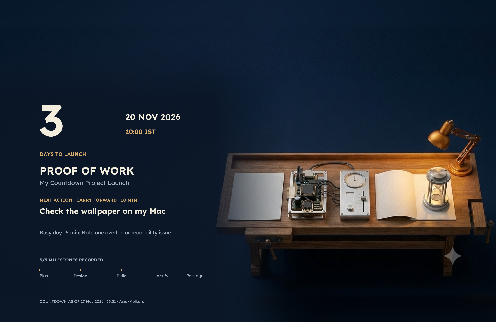
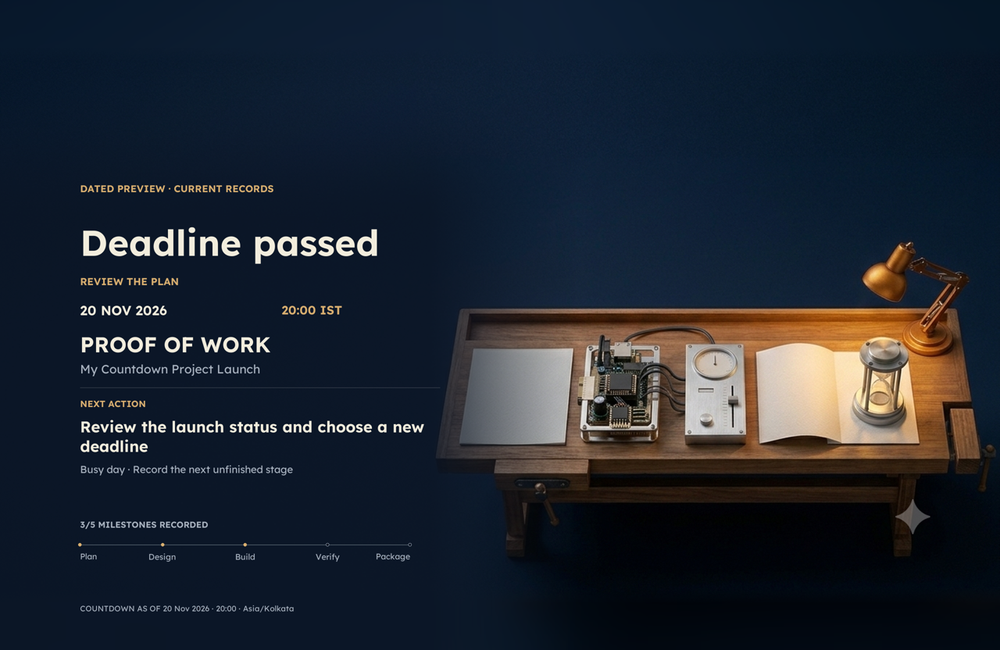

# PROOF OF WORK
## My Countdown Project Launch

**[Open the project website](https://proof-of-work-countdown.siddiqueraiyan2001.chatgpt.site/)** — preview the wallpaper and download the files without signing in.

A calm countdown wallpaper for my MacBook Air: one deadline, one useful next action and five milestones backed by recorded work.


**Personal deadline:** 20 November 2026, 8:00 p.m. IST (`Asia/Kolkata`).  
**Edition:** 17 November 2026 · **3 calendar days remaining** · **3/5 milestones recorded**.

[Open the full-size wallpaper](final-lock-screen.png) · [Read the one-page project summary](project-summary.pdf) · [Download the cover](cover.png)



### What it does

- Shows a correct calendar-day countdown in the named timezone.
- Keeps time remaining separate from completed work.
- Gives one useful next action and a smaller five-minute fallback.
- Carries missed work forward without automatically filling a progress dot.
- Exports a crisp 2560 × 1664 PNG, a reduced preview and a matching 3:2 cover.

This is a **static image**. Refresh it locally and replace the wallpaper manually; it is not a live lock-screen integration or a background app.

### Current project state

| Stage | Recorded state |
| --- | --- |
| Plan | Complete: bounded goal, capacity, milestones and recovery rule |
| Design | Complete: original Gemini workshop and precise composition |
| Build | Complete: working exporter and fresh passing tests |
| Verify | Pending: actual installed Mac clock/control and crop check |
| Package | Local files prepared; final acceptance follows the actual device check |

**Next action:** Check the wallpaper on my Mac — 10 minutes.  
**Busy day:** Note one overlap or readability issue — 5 minutes.

The native display resolution was observed on the actual Mac. Installed lock-screen fit has **not** been observed. The [laptop mockup](device-mockup.png) is labeled illustrative and is not installation proof.

### The plan

The working allowance is 60 minutes a day, with no excluded days supplied. The remaining device and handoff checks are short tasks on 16–18 November. Keep 19–20 November for corrections and recovery; finish a final review by 6 p.m. on the deadline day. After a missed day, resume the earliest unfinished prerequisite without doubling the next day’s load. See the [active plan](source/PLAN.txt).

### Who made what

Google Gemini developed the **earlier portfolio-brief backward plan** and generated the original miniature workshop artwork. The owner changed the goal to launching this countdown project. ChatGPT coordinated the adaptation, restored the local renderer, and typeset the current wallpaper and cover. These final images are disclosed local derivatives of genuine Gemini artwork, not unmodified Gemini downloads.

The original artwork was recovered byte-for-byte from its original download. Genuine sent prompts and available planning responses are retained in the private working package; a missing section of a deleted revision has not been fabricated. No new Gemini conversation is claimed for this recovery edition.

### Refresh it

Download this repository, then from the `source` directory:

```sh
python3 -m venv .venv
.venv/bin/python -m pip install -r requirements.txt
.venv/bin/python scripts/refresh.py
```

The exporter uses the current instant and `Asia/Kolkata`. On 20 November before 8 p.m. it says **Due today**. At or after the cutoff it says **Deadline passed**, unless real completion has been recorded. A zero-day count does not prove completion.

Edit `source/config/project.json` to change the goal, deadline or recorded evidence. Keep milestone and task status truthful. The renderer never changes progress by itself. The font and its SIL Open Font License are included. Ordinary export uses Python and Pillow only.

[Installation and refresh instructions](INSTALL-AND-REFRESH.txt) · [Renderer details](source/renderer/README.md)

### Checked behavior

- 14 focused renderer tests passed after restoration.
- 11 actual-configuration date cases and 4 timezone/immutability checks passed.
- Full-size and reduced wallpaper exports, the cover and the one-page PDF were inspected.
- Future previews below retain the actual **3/5** ledger; they are illustrative, not future progress claims.

| Day before | Deadline date before cutoff | At the cutoff |
| --- | --- | --- |
|  |  |  |

### Submission context

Prepared for Handshake’s [Your Deadline, Your Design](https://joinhandshake.com/learn/your-deadline-your-design-create-a-countdown-lock-screen-e748e649/) mission. Final submission remains manual. Reminders are optional and unconfigured. No extra spending was used.

The contest closes 23 November 2026 at 11:59 p.m. Pacific, separately from the personal goal above. The [official rules](https://go.joinhandshake.com/rs/390-ZTF-353/images/Google_%20AI_Skills_Studio_Challenge_Contest_Official_Rules.pdf) do not explicitly settle local typography/rendering in their automation clause; this project discloses its method and does not assert organizer approval or a prize outcome.
